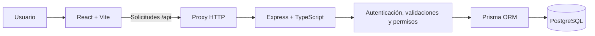

# MisGastos — Gestión de finanzas personales

**MisGastos** es una aplicación web para organizar las finanzas personales desde un mismo lugar. Permite registrar ingresos y gastos, clasificarlos por categorías, definir presupuestos y consultar resúmenes para comprender mejor el uso del dinero.

Es un proyecto académico de **Programación Web de la Universidad Rafael Landívar**, desarrollado con una arquitectura de frontend, API REST y base de datos relacional.

> **Alcance:** este repositorio contiene el código fuente y las configuraciones de desarrollo e infraestructura. La disponibilidad de una versión pública depende de que los servicios de despliegue estén configurados y verificados.

## Funcionalidades y módulos

| Módulo | ¿Qué permite hacer? |
| --- | --- |
| **Autenticación y sesiones** | Registrarse, iniciar y cerrar sesión. Gestiona la identidad del usuario mediante JWT y cookies de sesión. |
| **Categorías** | Consultar categorías generales y administrar categorías personales de ingreso o gasto. |
| **Movimientos financieros** | Registrar, consultar, editar y eliminar ingresos y gastos, con monto, fecha, descripción y categoría. |
| **Presupuestos** | Crear y administrar límites de gasto por categoría y período para dar seguimiento a la planificación financiera. |
| **Dashboard** | Visualizar ingresos, gastos, balance y distribución de gastos por categoría para un período seleccionado. |
| **Administración** | Gestionar el estado de cuentas y las categorías generales del sistema, con permisos diferenciados. |

Los usuarios normales administran **sus propios datos financieros**. Las funciones administrativas requieren un rol autorizado y no están diseñadas para exponer los movimientos privados de otros usuarios.

## Guía rápida de uso

1. **Crear una cuenta o iniciar sesión** desde la página de bienvenida.
2. **Revisar las categorías** disponibles o crear categorías personales para organizar los registros.
3. **Registrar ingresos y gastos** indicando el monto y la categoría correspondiente.
4. **Configurar presupuestos** y consultar el dashboard para observar el comportamiento de los gastos.
5. **Cerrar sesión** al terminar de utilizar la aplicación.

Esta es solo una orientación inicial. El **manual de usuario ilustrado**, con capturas y procedimientos detallados, se incorporará como documento complementario cuando esté finalizado.

## Tecnologías utilizadas

| Capa | Herramientas |
| --- | --- |
| Frontend | React, TypeScript, HTML, CSS y Vite |
| Backend | Node.js, Express, TypeScript y API REST |
| Base de datos | PostgreSQL y Prisma ORM |
| Autenticación y validación | JWT, bcryptjs, cookies HttpOnly y Zod |
| Pruebas | Vitest, Supertest y Playwright |
| Infraestructura | Docker, Docker Compose y GitHub Actions |
| Despliegue previsto | Vercel (frontend), Render (API) y Neon (PostgreSQL) |

## Arquitectura general



En desarrollo, el frontend usa un proxy local hacia la API. Para el despliegue en Vercel, el repositorio incluye una función que reenvía solicitudes `/api/*` al backend. Las credenciales de la base de datos y los secretos de autenticación se mantienen fuera del código fuente.

## Organización del repositorio

```text
MisGastos/
├── apps/
│   ├── web/
│   │   ├── src/                 # Pantallas, componentes y cliente HTTP
│   │   ├── api/                 # Proxy HTTP para Vercel
│   │   └── vercel.json          # Configuración de Vercel
│   └── api/
│       ├── src/modules/        # Auth, categorías, movimientos, presupuestos, dashboard y admin
│       ├── src/middleware/     # Autenticación y autorización
│       ├── prisma/             # Esquema y migraciones de la BD
│       └── prisma.config.ts    # Configuración de Prisma
├── database/                   # Scripts SQL y referencias de la base de datos
├── tests/e2e/                  # Pruebas de extremo a extremo
├── docs/                       # Documentación técnica
├── .github/workflows/          # Integración continua
├── compose.yaml                # PostgreSQL local con Docker Compose
├── Dockerfile                  # Imagen del backend
└── package.json                # Scripts del monorepo
```

## Instalación y ejecución local

### Requisitos

- Node.js **22.12 o superior** y npm.
- Git.
- Docker Desktop (o Docker Engine con Compose).

### 1. Obtener el código

```bash
git clone https://github.com/DonAlvarado/MisGastos.git
cd MisGastos
npm ci
```

### 2. Configurar variables de entorno

Crea tus archivos locales a partir de los ejemplos:

```bash
cp .env.example .env
cp apps/api/.env.example apps/api/.env
```

Configura los valores de acuerdo con tu entorno:

| Archivo | Variables principales |
| --- | --- |
| `.env` | `POSTGRES_USER`, `POSTGRES_PASSWORD`, `POSTGRES_DB`, `JWT_SECRET` |
| `apps/api/.env` | `DATABASE_URL`, `DIRECT_URL`, `JWT_SECRET`, `CLIENT_ORIGIN`, `PORT` |
| `apps/api/.env` (solo datos de prueba) | `LOCAL_DEMO_PASSWORD` |

**Importante:** la contraseña de PostgreSQL debe coincidir con la utilizada en `DATABASE_URL` y `DIRECT_URL`. Usa secretos nuevos y seguros; **nunca publiques archivos `.env` ni contraseñas reales**. Si ya existe un volumen de PostgreSQL, cambiar una contraseña en `.env` no modifica automáticamente las credenciales de esa base de datos.

### 3. Iniciar PostgreSQL y preparar la base de datos

```bash
docker compose up -d db
docker compose ps
npm run prisma:generate
npm run db:migrate
```

El contenedor debe aparecer como **healthy**. Las migraciones preparan la estructura y restricciones de PostgreSQL. No utilices `prisma db push` ni `prisma migrate reset` sobre una base con información que debas conservar.

Para cargar usuarios **solo en el entorno local**, define previamente `LOCAL_DEMO_PASSWORD` en `apps/api/.env` y ejecuta:

```bash
npm run db:seed
```

Los correos de demostración son `demo@misgastos.local` y `admin@misgastos.local`; ambos usan la contraseña local que hayas definido. **No ejecutes el seed de demostración en producción.**

### 4. Iniciar la aplicación

```bash
npm run dev
```

- **Aplicación web:** http://localhost:5173
- **Estado de la API:** http://localhost:3001/api/health

## Pruebas y calidad del código

Desde la raíz del repositorio:

```bash
npm run prisma:generate
npm run typecheck
npm test
npm run build
npm audit
```

Para las pruebas E2E, inicia los servicios locales, instala el navegador de Playwright si es necesario y ejecuta:

```bash
npx playwright install chromium
npm run e2e
```

Algunas pruebas E2E requieren que la base de datos y el usuario de demostración estén preparados. Consulta la configuración de Playwright y los archivos de prueba para conocer sus precondiciones.

## Seguridad y protección de datos

El proyecto contempla controles como contraseñas almacenadas mediante hash, sesiones JWT en cookies HttpOnly, validación de datos, autorización por roles y propiedad de registros, limitación de intentos y encabezados de seguridad. También se aplican restricciones e integridad referencial en PostgreSQL.

Estas medidas deben complementarse con pruebas funcionales y de seguridad antes de utilizar datos financieros reales. No almacenes información sensible de terceros en la base de demostración.

## Documentación complementaria

- [Arquitectura del sistema](docs/ARQUITECTURA.md)
- [Seguridad](docs/SEGURIDAD.md)
- [Despliegue](docs/DESPLIEGUE.md)
- [Organización del equipo y Git](docs/EQUIPO_Y_GIT.md)
- **Manual de usuario con capturas (PDF):** pendiente de incorporación al repositorio.

## Colaboración

El proyecto se desarrolla mediante ramas de trabajo y **Pull Requests** hacia `main`. Las contribuciones deben incluir una descripción de los cambios y las verificaciones correspondientes. GitHub Actions ayuda a comprobar el estado del código antes de integrarlo.

---

**Proyecto académico · Universidad Rafael Landívar · Programación Web · 2026**
